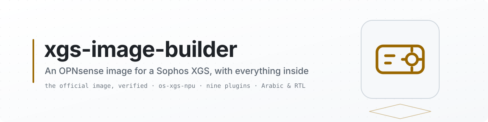
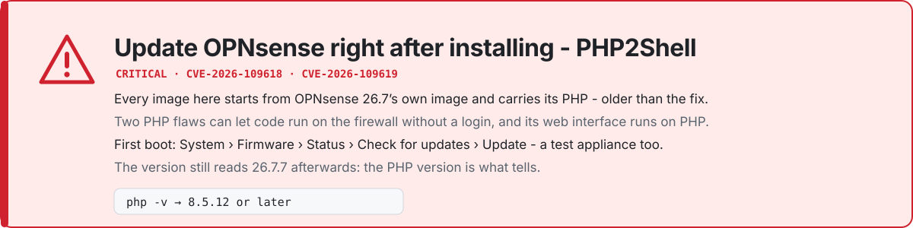

<picture>
  <source media="(prefers-color-scheme: dark)" srcset="docs/images/banner-dark.svg">
  <source media="(prefers-color-scheme: light)" srcset="docs/images/banner-light.svg">
  
</picture>

<picture>
  <source media="(prefers-color-scheme: dark)" srcset="docs/images/notice-dark.svg">
  <source media="(prefers-color-scheme: light)" srcset="docs/images/notice-light.svg">
  
</picture>

> [!CAUTION]
> **Update OPNsense right after installing an image - a test appliance too. PHP2Shell, 2026-10-21.**
> Every image here, built or downloaded, starts from OPNsense 26.7's own image and carries the PHP that
> image has, older than the fix for CVE-2026-109618 and CVE-2026-109619 - two flaws
> [php.net](https://www.php.net/archive/2026.php) says can allow remote code execution without a login;
> OPNsense's web interface runs on PHP. ~~OPNsense delivers the fix, **PHP 8.5.12**, to 26.7.7 as an
> out-of-band package update ([its announcement](https://forum.opnsense.org/index.php?topic=53191.0)), so
> **the version still reads 26.7.7 afterwards**.~~ Since OPNsense 26.7.8 the fix, **PHP 8.5.12**, comes
> with OPNsense's own update: it takes the appliance to 26.7.8 - base, kernel and packages, with a
> reboot - and **the version reads 26.7.8 afterwards** (26.7.8_1 with the hotfix that followed).
>
> - **At the first boot**, before the web interface can be reached from a network you do not trust:
>   System: Firmware: Status - *Check for updates*, then *Update*.
> - **Check:** in a shell (the console's option 8, or SSH), `php -v` reads **8.5.12** or later.
> - **The captive portal**, if you run it: restart it after the update, as OPNsense advises.

> [!NOTE]
> **Still being completed.** The main part of the work is done. Some functions are being improved, and
> the XGS-specific integration is being completed where something is still missing - each gap is on the
> [driver project's parity page](https://github.com/AbdelmonemAwad/os-xgs-npu/blob/main/docs/families/parity.md) -
> and it all arrives as updates, through its [releases](https://github.com/AbdelmonemAwad/os-xgs-npu/releases).
> An image built here installs the newest one.

<p align="center">
  <a href="https://github.com/AbdelmonemAwad/xgs-image-builder/actions/workflows/checks.yml"></a>
  <a href="https://github.com/AbdelmonemAwad/xgs-image-builder/actions/workflows/build.yml"></a>
  <br>
  <a href="https://github.com/AbdelmonemAwad/os-xgs-npu/releases"></a>
  <a href="#why-only-267-in-the-release-list"></a>
  <a href="#what-is-in-the-image"></a>
  <a href="#status"></a>
  <a href="#why-it-works-this-way"></a>
  <a href="LICENSE"></a>
</p>

Build a bootable OPNsense image for a Sophos XGS appliance, with the
[os-xgs-npu](https://github.com/AbdelmonemAwad/os-xgs-npu) driver and plugin already in it, and
the Arabic translation, the right-to-left layout, the XGS Silicon theme and ~~four~~ nine appliance
plugins beside it - eight when it is built without the front panel.

<p align="center"><a href="https://github.com/AbdelmonemAwad/xgs-image-builder/releases/latest"><b>Download a ready-made image</b></a> - or <a href="https://npuforge.org/build/"><b>open the build page</b></a> to pick the OPNsense release, the console speed, the driver and the front panel, and have yours built. Nothing to install.</p>

## Ready-made images

~~For each os-xgs-npu release~~ For each main os-xgs-npu release - started by its release as it is published, and found by a look every six hours besides; a small release, whose number has a fourth part, has no images of its own (2026-10-24) - [`release-images.yml`](.github/workflows/release-images.yml) builds
four images and publishes them as a [release of this repository](../../releases), named
`images-` and that release's tag, with a `SHA256SUMS` beside them:

| Image | For |
|---|---|
| `serial-38400-front-panel` | the rack models, an LCD and keys on the front - XGS 2100, 2300, 3100, 3300 - console at 38400 baud |
| `serial-38400` | the desktop models, no front panel - XGS 87, 107, 116, 126, 136, 138 and their w twins - console at 38400 baud |
| `serial-115200-front-panel` | the rack models, console at 115200 baud |
| `serial-115200` | the desktop models, console at 115200 baud |

Each image is for every model of its kind: it carries both drivers and the kernel sources they are
built from, and the appliance installs the one its own board names at its first boot. The XGS 136
and the XGS 3300 are the two run by the project; the others are untested.

All four are OPNsense 26.7 with the console on the serial port alone - an XGS has no video output -
at 38400 baud, the speed the Sophos firmware uses on the same port, or at 115200, OPNsense's own. It
is the same build a request from the page runs, called with those values, so everything below about
what is in an image holds for them too. Any other combination is built from the page, ~~in your own
account~~ here, for anyone who asks, since 2026-11-01. A
release here says plainly whether its own files have been booted on an appliance.

### Checking an image

- **The download** against the release's `SHA256SUMS`: `sha256sum -c SHA256SUMS --ignore-missing`,
  or on Windows `Get-FileHash .\<file>.img.xz -Algorithm SHA256`.
- **Where it was built.** Every image built here since 2026-10-24 - the ready-made ones, the ones built on
  request, and a fork's own - has a build attestation, signed through GitHub and kept by it, naming the repository, the
  workflow and the commit it ran from:

  ```
  gh attestation verify <file>.img.xz -R AbdelmonemAwad/xgs-image-builder
  ```

  and for an image built in a fork, `-R <owner>/<fork>`. A private fork makes none: GitHub's free
  plans keep attestations for public repositories only. An attestation says where a file came from,
  not that it is good.
- **What it was built from.** The official OPNsense image, its checksum checked against the list
  OPNsense publishes before anything is added - the run's log shows both - and os-xgs-npu at the
  commit the image records in `/usr/local/share/os-xgs-npu/source/.image-build`.
- **The driver is not in it as a binary.** The appliance compiles it at its first boot, from the
  source the image carries and against the kernel sources beside it.
- **Not bit-for-bit reproducible.** The same build run twice gives two different files - the image's
  file system records when each file was written - so the checksum and the attestation are the
  checks, not a second build.

## The two appliances it builds for

<picture>
  <source media="(prefers-color-scheme: dark)" srcset="https://raw.githubusercontent.com/AbdelmonemAwad/os-xgs-npu/main/docs/images/readme/status-dark.svg">
  <source media="(prefers-color-scheme: light)" srcset="https://raw.githubusercontent.com/AbdelmonemAwad/os-xgs-npu/main/docs/images/readme/status-light.svg">
  
</picture>

*Read from [os-xgs-npu](https://github.com/AbdelmonemAwad/os-xgs-npu), not copied, so it is that
project's board as it stands today: one card per appliance, the same rows on both - every feature,
what has been measured, and how far along it is
([side by side](https://github.com/AbdelmonemAwad/os-xgs-npu/blob/main/docs/families/parity.md)).
An image built here installs that project's newest release, so it carries what the board shows.*

## At a glance

- **Nothing to install.** ~~One static page - every style and line of script in one file -~~ The build
  page, [on npuforge.org](https://npuforge.org/build/) since 2026-11-01, that fills in a build request, follows it,
  and hands over the image.
- **The official image underneath.** Fetched from OPNsense's own mirror at build time and verified;
  this repository holds no part of it.
- **The driver's newest release.** `latest` by default: the version every appliance's Updates page
  offers, so an image starts where an update would take it - not on whatever was merged last.
- **Everything at the first boot.** The driver built against the kernel the appliance runs, the
  Arabic translation and the right-to-left layout, the XGS Silicon theme, ~~four~~ eight plugins, and
  the front panel's where there is a panel - each keeping itself across OPNsense updates.
- **Followed to the end.** A bar at the top of the page follows the build - requested, accepted,
  queued, building step by step, image ready - and its clock stops the moment the image exists.
- **Nothing kept** of what you build. Your image is an artifact of ~~your own~~ its run, and it expires
  in ~~seven days~~ one day. The ready-made ones above are the only images kept here.

Since 2026-11-01 a build runs here for anyone who files a request from
[the build page](https://npuforge.org/build/) - build.npuforge.org leads there - with three limits: the driver as `latest` or one of its releases, one build at a time, and three builds a day for every account but the owner's (`tools/request-limits.py`).

> [!WARNING]
> ~~**Nothing built here has been booted on an appliance.**~~ ~~**One image built here has been
> installed on an appliance**~~ **Two images built here have been installed, one on each family**:
> OPNsense 26.7, serial, 38400 baud, on an XGS 3300 (2026-10-16), which then assigned its own front
> ports at its first boot from disk; and OPNsense 26.7, serial, 115200 baud, on an XGS 136
> (2026-10-21), its front ports up at the first boot, then updated to 26.7.7 from the GUI - the
> reboot held until the driver was built for the new kernel - and its configuration restored
> ([measured](https://github.com/AbdelmonemAwad/os-xgs-npu/blob/main/docs/measurements/image-136-2026-10-21.md)).
> No other combination has been booted. The build runs on a GitHub runner, which has no Sophos hardware attached to it and never
> will. Burn an image and boot it before relying on it.

## How it is meant to be used

1. Open **[the build page](https://npuforge.org/build/)**, then **Build your own**, and choose: the OPNsense release,
   the console speed - 38400, the vendor firmware's, or 115200, OPNsense's own - the driver, `latest`
   or one of its releases, and whether the image carries the front panel plugin.
2. Press **Build on GitHub**. GitHub opens with the request filled in; sign in and press **Submit new
   issue**. That press is the authentication, which is why no token is asked for.
3. The page follows the request and its run, step by step, and when the image is made it hands it
   over. Download it signed in to GitHub, then write it to a USB stick.

Each account has three builds a day, one at a time, with the driver's newest release or a published
one. The image expires on its own, a day after it is made. Nothing is kept.

With write access - in a fork, say - the same choices are the workflow's own inputs:
**[Build image -> Run workflow](../../actions/workflows/build.yml)**. That is where GitHub renders
them, and the only place it can - a README cannot hold them, because GitHub strips `<form>`,
`<select>` and `<input>` out of Markdown.

## Why it works this way

This repository holds **no part of any OPNsense image**. The workflow fetches the official image
from OPNsense's own mirror at build time, verifies it, and adds this project's files to it.

~~That is not only to keep the repository small. Because the build runs in *your* fork, under *your*
account, the image is something you built for yourself from an upstream image you obtained from
upstream. This repository distributes its own code and nothing else.~~

That keeps the repository small, and it keeps every image traceable to the official one it was
made from. The ready-made images are published here too, since 2026-10-23, when the OPNsense
project answered that its licence and trademark terms
([its legal guidelines](https://opnsense.org/legal-guidelines/)) hold nothing back from it. They
keep OPNsense's notices as they are, carry a descriptive name only - "based on OPNsense 26.7" - and
hold no Sophos software or firmware ([CONTRIBUTING.md](CONTRIBUTING.md)).

OPNsense is a trademark of Deciso B.V. Nothing here is endorsed by or affiliated with them, and the
name is used only to say which system the image is built from.

## The console speed matters more than it looks

An XGS appliance has no screen. OPNsense defaults its serial console to **115200**, and Sophos
firmware uses **38400** on the same port. Choose the wrong one and the appliance boots perfectly
into a console you cannot read. The dropdown exists for that reason.

The speed chosen is written everywhere the port's speed is decided, not only in the loader: the
loader (`/boot/loader.conf.local`), the boot blocks (`/boot.config`), and OPNsense's own default
configuration (`serialspeed` in `/usr/local/etc/config.xml`). The last one matters most. At every
boot OPNsense rewrites the login prompt's speed in `/etc/ttys` from that setting, and the serial
image ships 115200 - so until 2026-10-16 an image built for 38400 booted readably and then printed
its login prompt at 115200, which a 38400 terminal shows as garbage. With "serial only" off, the
screen is set as the second console too, so it gets a login prompt of its own.

## What is in the image

Everything the project supports, for every appliance family, with the selection made **at first
boot** rather than at build time: the installer branches by family, and each boot hook checks for
its own hardware and exits quietly when it is not there. One image, any supported board.

The driver is **not** shipped prebuilt. It is built on the appliance against that kernel's own
sources, on first boot, because a module built against a different kernel loads silently and
would be broken by the first update.

Beside the driver, each from its own repository at the ref [components.list](components.list)
names, and each recorded by commit in the build's summary:

| | what it is | on after first boot |
|---|---|---|
| [opnsense-arabic](https://github.com/AbdelmonemAwad/opnsense-arabic) | the GUI in Arabic | in the language list; the GUI **stays English** until Arabic is chosen |
| [opnsense-rtl](https://github.com/AbdelmonemAwad/opnsense-rtl) | the right-to-left layout for it | applied; it shows only when the language is Arabic or Persian |
| [os-theme-xgs](https://github.com/AbdelmonemAwad/os-theme-xgs) | XGS Silicon: light, dark, and `xgs-auto`, which follows the browser's own setting | **the GUI's theme**, `xgs-auto`; another is a choice in System: Settings: General |
| [os-netreport](https://github.com/AbdelmonemAwad/os-netreport) | scheduled network reports | on as installed |
| [os-linkhealth](https://github.com/AbdelmonemAwad/os-linkhealth) | port and cable health | on as installed |
| [os-fanctl](https://github.com/AbdelmonemAwad/os-fanctl) | fans and temperatures | on, in its watch-only mode: it never writes to a fan chip until a curve is chosen |
| [os-frontpanel](https://github.com/AbdelmonemAwad/os-frontpanel) | the LCD and keys | in the image **only when the build page's "Front panel" is yes** - a rack model such as the XGS 3300; a desktop such as the XGS 136 has none - and on where the plugin's own table has a confirmed entry for the model |
| [os-watchdog](https://github.com/AbdelmonemAwad/os-watchdog) | the host's hardware watchdog, and why it last reset | on; with os-xgs-npu arming the timer it stands aside and only shows it |
| [os-kernelfollow](https://github.com/AbdelmonemAwad/os-kernelfollow) | kernel modules rebuilt for the kernel the next boot takes | on; os-xgs-npu's own modules are left to os-xgs-npu's follower, and nothing else is registered |
| [os-blocklists](https://github.com/AbdelmonemAwad/os-blocklists) | address, DNS, country and JA4 block lists | on, with no list chosen: it blocks nothing until lists are chosen in its Settings |
| [os-portguard](https://github.com/AbdelmonemAwad/os-portguard) | devices blocked by their MAC address | on, with no device listed: it blocks nothing until one is |
| [os-fallbackcrypto](https://github.com/AbdelmonemAwad/os-fallbackcrypto) | which crypto driver encrypts IPsec on the host | as OPNsense ships (AES-NI) until another choice is applied |

The front panel needs LCDproc, so when the front panel is asked for its packages are fetched at
build time from the OPNsense
repository the image itself is set up for, and installed from those files at first boot: on an
XGS 3300 there is no network until the driver exists, because the WAN is one of the
coprocessor's own ports.

**The order is fixed, and it matters.** The first-boot hook in `scripts/inject.sh` installs the
driver first (the network may depend on it), then LCDproc where there is a panel, then the translation (three plugins add
their own Arabic strings to its catalog and skip a language whose catalog is missing), then the
layout, then the theme (its installer has the layout mirror it) and makes it the GUI's theme, then
the plugins, then turns them on. Each step is done once and marked; one that fails is
logged in `/usr/local/share/xgs-image/firstboot.log` and tried again at the next boot, and does not stop the
others.

**Each piece keeps itself across OPNsense updates.** An update replaces the files the translation,
the layout and the plugins' strings live in, and an update that only installs packages does not
reboot. So each installs a pkg trigger, which pkg runs the moment an update writes into those
directories, and a boot hook - in its own repository, where the change belongs.

**And each keeps itself up to date.** The driver from ~~System - Firmware - XGS Coprocessor~~
**XGS Coprocessor - Updates**, which offers the project's releases (since 2026-10-18), ~~the others by
themselves once a day from their own repository's latest release~~ the others from the Plugins tab of
XGS - Updates, and with every update of the project since 0.1.0-alpha.8.2, each from its own
repository's latest release. Both move only forward from what
is installed, which they read from the commit this builder writes into each tree as `.source-commit`
(the driver's as `.image-build`, with the release's tag beside the commit when a release was
installed): with `.git` removed from the image that is the only record of it, and without it a
release older than the image would be taken.

## Why only 26.7 in the release list

Because the driver needs FreeBSD 15. It uses FreeBSD's IPsec offload interface
(`netipsec/ipsec_offload.h`, `IFCAP2_IPSEC_OFFLOAD`), which OPNsense has from 26.7 on; 26.1 and the
25.x releases are FreeBSD 14.x, and the module does not compile there. An image of one of those
would boot with no front ports and, on an XGS 3300, no WAN. A newer release goes into the list once
it is published and checked against the same two names.

## Before you change anything here

Read [CONTRIBUTING.md](CONTRIBUTING.md). It carries the publishing rules and the two decisions that
shape the image, and it is short.

## Status

Nothing here is finished. See the issues.

- **Installing an image** is on the build page, step by step: write the image to a stick, boot it, install to the disk, and at
  the first boot from the disk a thirty-second countdown on the console assigns the front ports -
  WAN on Port2 (XGS 3300) or Port1 (XGS 136), every other front port in one bridge as LAN on
  192.168.1.1, and the management port, where there is one, as MGMT on 192.168.100.1. A key during
  the countdown leaves the assignment to OPNsense's own menu.
- **What the driver project measured on the appliances since** - IPsec with the coprocessor's engine
  at both ends of a tunnel, jumbo frames through the switch chip, the MTU from 576 to 9000 - is in
  its [measurements](https://github.com/AbdelmonemAwad/os-xgs-npu/tree/main/docs/measurements);
  an image built here installs that project, so it carries all of it.

## ⚖️ Licence

**BSD-2-Clause** - [LICENSE](LICENSE) is the whole of it.

Copyright &copy; 2026 Abdelmonem Awad. **OPNsense&reg;** is a registered trademark of Deciso B.V.;
**Sophos&reg;** and **XGS** are trademarks of Sophos Ltd. This project is independent: it is not
affiliated with, endorsed by or sponsored by either, and their names are used only to say what an
image built here is made from and runs on.
